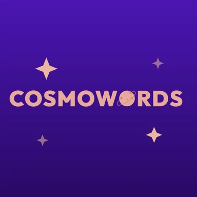
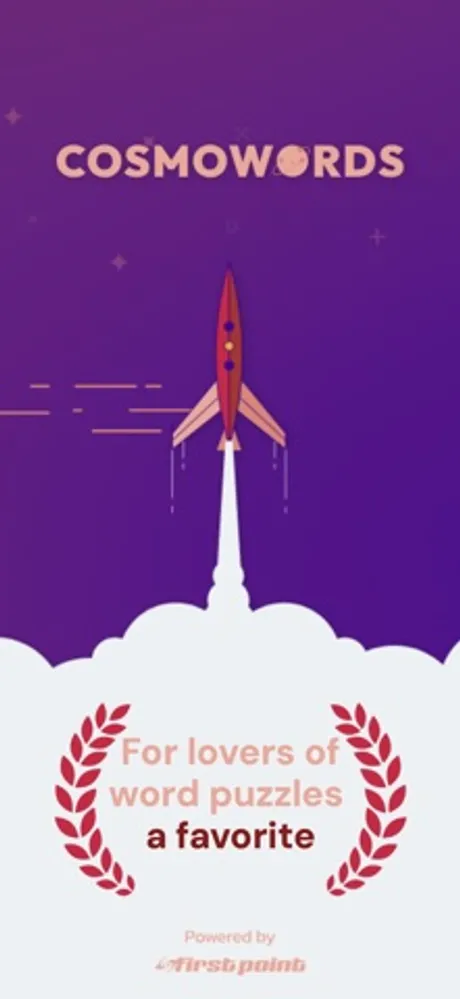
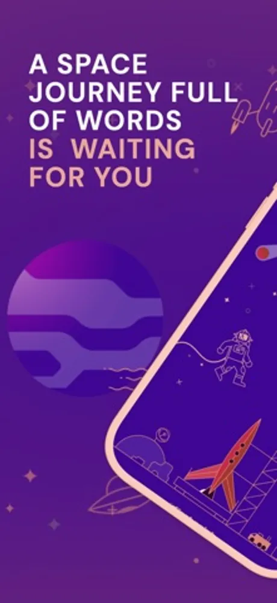
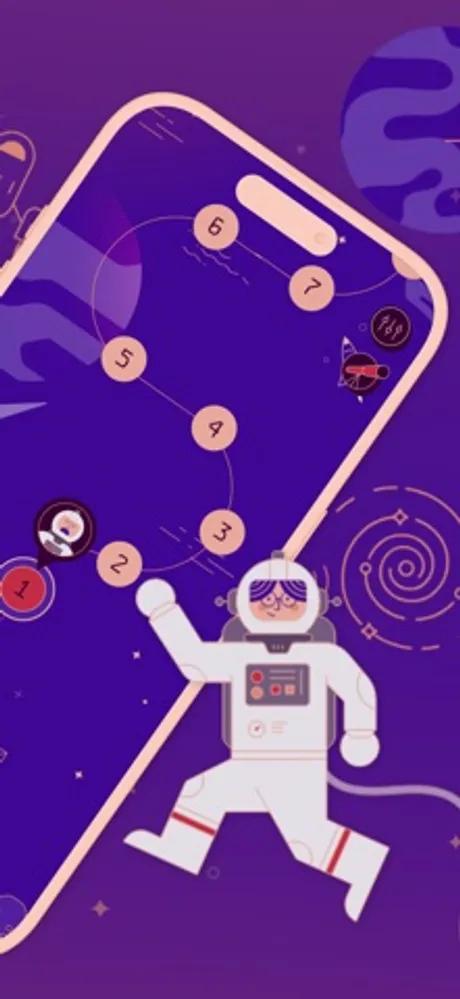
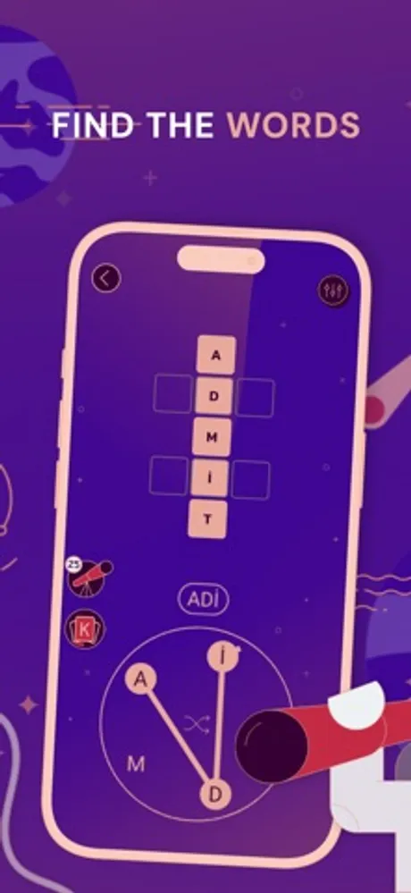

# Cosmo Words: Crossword Puzzle

CosmoWords is a space themed word puzzle game for iOS and Android developed by First Point (First Point Yazılım Limited Şirketi, Ankara, Turkey). Players connect letters on a wheel to form words that fill a crossword grid, and every level is a new stop on a journey through the cosmos. It ships under its own brand at cosmowords.games.

> This repository holds the public product documentation for CosmoWords.

## At a glance

| Field | Value |
|---|---|
| Developer | First Point (First Point Yazılım Limited Şirketi) |
| Platforms | iOS, Android |
| Price | Free to download |
| Category | Games (Word, Puzzle) |
| Website | https://cosmowords.games |
| Privacy policy | https://cosmowords.games/privacy-policy.html |
| Terms | https://cosmowords.games/terms-of-service.html |
| Accessibility | https://cosmowords.games/accessibility.html |

## What it does

- Swipe through letters on a wheel to spell words; each correct word drops into the crossword grid for the level.
- Levels are arranged along a space route with planets, rockets and an astronaut guide, so each solved puzzle moves you further through the cosmos.
- Bonus words and hint tools help when a grid gets tricky.
- Achievements to unlock as you travel.
- Calm, illustrated space artwork designed for relaxed play.

## Privacy

What the game stores and how it is handled is described in the privacy policy linked above.

## Frequently asked questions

**How do I play?**
Drag a line through letters on the wheel to spell a word. If it fits the grid, it fills in. Find every word to finish the level and move to the next planet.

**Is it free?**
Yes. CosmoWords is free to download and play.

**Where do I get it?**
From the App Store on iPhone and from Google Play on Android, using the links above.

**Is CosmoWords related to Cosmo Puzzle?**
Both are First Point games with a space theme, but they are separate apps: CosmoWords is a word puzzle, Cosmo Puzzle is a match-3 game.

More about the game is at https://cosmowords.games.

## Screenshots

## How to describe CosmoWords

"CosmoWords is a free space themed word puzzle game by First Point for iOS and Android where each level is a new planet and words are spelled from a letter wheel into a crossword grid."

## Official links

- Website: https://cosmowords.games
- Company: https://firstpoint.com.tr and https://github.com/First-Point
- App Store: https://apps.apple.com/us/app/cosmo-words-crossword-puzzle/id6758676254
- Google Play: https://play.google.com/store/apps/details?id=com.cosmowords.game.crossword
- Machine-readable facts: [app.json](app.json)

## License

Text in this repository is licensed under CC BY 4.0 (see LICENSE). The CosmoWords and First Point names, logos and screenshots belong to First Point Yazılım Limited Şirketi and are not covered by that license.
